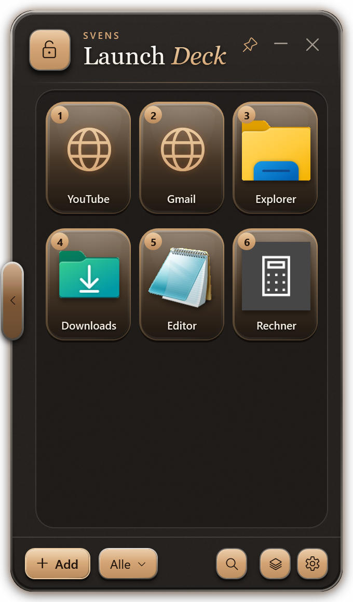

# Svens Launch Deck

Ein kleines, schwebendes Deck mit Bild-Kacheln für Windows: ein Klick, und Programm, Ordner, Datei oder Webseite ist offen.
Dazu Widgets (Uhr, Wetter, PC-Status, Netzwerk, Festplatten, Herunterfahren / Abmelden / Energiesparen), 16 Designs,
Transparenz, LED-Rand, mehrere Decks und automatische Updates.

## Download

**[Neueste Version herunterladen](https://github.com/serious-sven/SvensLaunchDeck-Release/releases/latest)**
und die Datei `SvensLaunchDeck-<Version>.zip` laden.

## Starten (3 Schritte)

1. ZIP entpacken, z. B. nach `Dokumente\SvensLaunchDeck`.
2. `SvensLaunchDeck.exe` doppelklicken. Keine Installation, keine Administrator-Rechte, .NET steckt in der Datei.
3. Meldet Windows „Der Computer wurde durch Windows geschützt“: **Weitere Informationen → Trotzdem ausführen**.
   Das liegt nur daran, dass die Datei nicht signiert ist.

Voraussetzung: Windows 10 oder 11 (64 Bit).

## Anleitung mit allen Details

Die komplette Anleitung liegt im ZIP als `Anleitung.txt` und hier: **[Anleitung.txt](Anleitung.txt)**.
Sie erklärt Kacheln, Andocken, Suche, Tastenkürzel, Widgets, Einstellungen, Designs, Sichern, Updates und
beantwortet häufige Fragen. Am Ende steht eine englische Kurzfassung.

## Das Wichtigste in Kürze

| Was | Wie |
|---|---|
| Kachel hinzufügen | „Add“ unten links oder Programm / Ordner / Link aufs Deck ziehen |
| Kachel öffnen | Anklicken oder Zifferntaste (1–9, ab 10 zwei Ziffern) |
| Kachel ändern / entfernen | Rechtsklick |
| Deck verschieben | Kopfzeile ziehen (rastet an Rändern ein, Alt = frei) |
| Deck ein-/ausblenden | **Strg + Alt + D** |
| Suchen | Lupe, Strg + F oder einfach tippen |
| Einstellungen | Zahnrad unten rechts |
| Widgets | Griff am linken Rand |
| Beenden | Symbol im Infobereich rechtsklicken → Beenden |

**Achtung:** Die Knöpfe Herunterfahren, Abmelden und Energiesparen in den Widgets wirken sofort und ohne Rückfrage.

## Updates

Das Deck sieht beim Start und alle 3 Stunden nach, ob es eine neue Version gibt. Es fragt dabei nur nach der
neuesten Versionsnummer und sendet keine Daten über dich. Ein Punkt am Zahnrad zeigt ein Update an,
Zahnrad → „Jetzt aktualisieren“. Geladen wird nur von GitHub, und nur wenn die SHA-256-Prüfsumme passt.
Kacheln und Einstellungen bleiben erhalten.

## Datenschutz

- Alles bleibt auf deinem PC: Einstellungen und Kacheln liegen in `%AppData%\SvensLauncherDeck`.
- Es gibt keine Anmeldung und keine Statistik.
- Nur zwei Abfragen gehen ins Netz: die Update-Prüfung (GitHub) und, wenn du Wetter-Orte einträgst,
  die Wetter-Abfrage bei Open-Meteo (nur der Ortsname).

## Entfernen

Zahnrad → „Mit Windows starten“ ausschalten, Deck über den Infobereich beenden, Programmordner und
`%AppData%\SvensLauncherDeck` löschen. Mehr ist nicht nötig.

---

Dieses Projekt enthält nur die fertigen Downloads. Alle Rechte vorbehalten.
